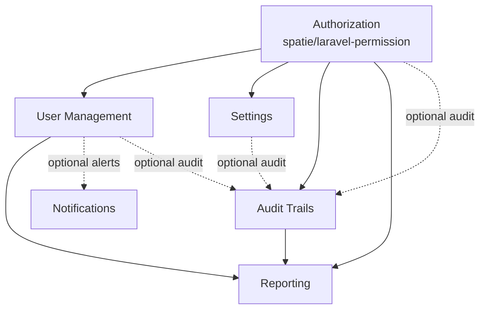
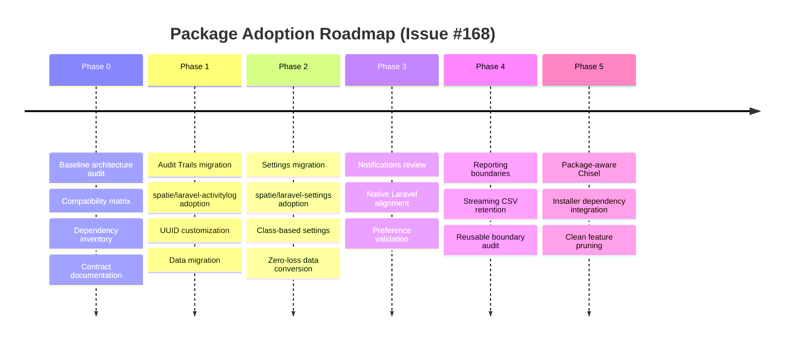

# Package Strategy & Baseline Compatibility Audit (Phase 0)

> **Document Status**: Complete Baseline Audit  
> **Related Issue**: [#168 — architecture: adopt existing Laravel packages and define an independent package strategy](https://github.com/tooinfinity/infinity-starter-kit/issues/168)  
> **Phase**: Phase 0 — Baseline and Compatibility Audit  
> **Author**: Infinity Starter Kit Architecture Team  
> **Target Runtime**: PHP `^8.5.0`, Laravel `^13.40.0`, React `^19.3.0`, TypeScript `^7.0.2`

---

## 1. Executive Summary & Objective

This document establishes the architecture baseline, package evaluation, compatibility matrix, and migration plan for **[tooinfinity/infinity-starter-kit](https://github.com/tooinfinity/infinity-starter-kit)** in accordance with [Issue #168](https://github.com/tooinfinity/infinity-starter-kit/issues/168).

### 1.1 Core Strategy
The starter kit follows a three-part package strategy:
1. **Adopt mature, battle-tested Laravel ecosystem packages** (e.g. Spatie packages) where they already solve the problem and meet strict compatibility, security, and UUID requirements.
2. **Keep starter-kit-specific orchestration, scaffolding, and application domain logic** in this repository (e.g. Chisel modular installer, Fortify authentication flows, shadcn/React UI, and domain reports).
3. **Extract independent Composer packages only when a stable, multi-application reusable boundary has been proven** across downstream deployments, avoiding premature extraction or creating thin wrappers around existing Laravel/Spatie features.

### 1.2 Target Downstream Applications
The package strategy is designed to support diverse business applications without imposing unnecessary dependencies or architectural friction:
- **Point of Sale (POS) & Inventory System**: High-concurrency transactions, offline-tolerant data sync, strict audit logging, and inventory-specific domain reports.
- **FTTH ERP & Project Management**: Multi-stage infrastructure deployments, work orders, geographic/network tracking, and heavy permission hierarchies.
- **Clinic Management System**: Patient records, appointment scheduling, medical practitioner roles, and HIPAA/GDPR-grade audit retention and immutable logs.
- **Queue Management System**: Real-time ticket dispensing, service desk routing, wall-board displays, and SLA performance dashboards.

---

## 2. Architecture Inventory of Affected Chisel Features

The starter kit features are modularly managed by **Laravel Chisel** (`app/Chisel/FeatureRegistry.php`). Below is the comprehensive baseline inventory of the six features identified in Issue #168.

```
┌────────────────────────────────────────────────────────────────────────┐
│                        CHISEL FEATURE INVENTORY                        │
├────────────────────┬───────────────────────────────────────────────────┤
│ Feature            │ Role & Architecture Boundary                      │
├────────────────────┼───────────────────────────────────────────────────┤
│ 1. Authorization   │ Spatie Laravel Permission + Enums + Form Requests │
│ 2. Settings        │ Key-value config with cached runtime application  │
│ 3. User Management │ Admin directory, profile, roles, and lifecycle    │
│ 4. Notifications   │ Database/email alerts + user channel preferences  │
│ 5. Audit Trails    │ Immutable actor-context logging + auto-pruning    │
│ 6. Reporting       │ Read-only domain metrics + zero-dep streaming CSV │
└────────────────────┴───────────────────────────────────────────────────┘
```

### 2.1 Feature 1: Authorization (`authorization`)
- **Key**: `authorization`
- **Section Marker**: `roles-permissions`
- **Composer Dependencies**: `spatie/laravel-permission` (`^8.3`)
- **Frontend Packages**: None (native TypeScript hook & component)
- **Database Tables**:
  - `permissions`: `id` (bigint), `name` (string), `guard_name` (string), `timestamps`.
  - `roles`: `id` (bigint), `name` (string), `guard_name` (string), `timestamps`.
  - `model_has_permissions`: `permission_id` (bigint FK), `model_type` (string), `model_id` (**uuid**), primary compound key.
  - `model_has_roles`: `role_id` (bigint FK), `model_type` (string), `model_id` (**uuid**), primary compound key.
  - `role_has_permissions`: `permission_id` (bigint FK), `role_id` (bigint FK), primary compound key.
- **Models & Enums**:
  - `App\Enums\Permission`: Backed string enum (`authorization.manage`, `users.*`, `settings.manage`, `audit.view`, `reports.*`).
  - `App\Enums\Role`: Backed string enum (`super-admin`).
  - `App\Models\User`: Uses `Spatie\Permission\Traits\HasRoles` and `HasUuids`.
- **Authorization Enforcement Pattern**:
  - **Policy-free**: No `app/Policies`, no `Gate::define()`, no `can:` middleware.
  - Authorization occurs exclusively in Form Requests: `$this->user()?->can(Permission::UsersView)`.
  - Super-admin bypass configured in `AppServiceProvider::boot()` via `Gate::before`.
- **Console Commands**:
  - `app/Console/Commands/SetupAuthorizationCommand.php`: Seeds permissions and default roles.
  - `app/Console/Commands/CreateAdminCommand.php`: Non-interactive admin provisioning.
  - `app/Console/Commands/SetupAdminUserCommand.php`: Interactive administrator setup.
- **Frontend UI & Components**:
  - `resources/js/components/can.tsx`: `<Can permission={Permission.UsersView}>{...}</Can>`.
  - `resources/js/hooks/use-authorization.ts`: `useAuthorization()` hook with `hasPermission()`, `hasRole()`, `isSuperAdmin`.
  - Shared via Inertia in `HandleInertiaRequests`: `auth.can`, `auth.roles`.
- **Inter-feature Dependencies**: Base dependency for `settings`, `user-management`, `audit-trails`, and `reporting`.

### 2.2 Feature 2: Settings (`settings`)
- **Key**: `settings`
- **Section Marker**: `settings`
- **Composer Dependencies**: None (custom implementation)
- **Database Tables**:
  - `settings`: `id` (**uuid primary key**), `key` (string unique), `value` (json nullable), `created_at`, `updated_at`.
- **Models & Enums**:
  - `App\Models\Setting`: `HasUuids`, casts `key` to `SettingKey::class`, `value` to `json`.
  - `App\Enums\SettingKey`: `application.name`, `application.timezone`, with validation rules, default values, and labels.
  - `App\Enums\SettingGroup`: `application`.
- **Actions & Queries**:
  - `App\Queries\SettingQuery`: Reads all settings cached under `'settings.all'` (1-hour TTL).
  - `App\Actions\UpdateSettings`: Mutates settings within `DB::transaction()` using `lockForUpdate()`, invalidates cache, and records audit trail if `audit-trails` is installed.
- **Middleware & Runtime Application**:
  - `App\Http\Middleware\HandleSettings`: Dynamically configures `config(['app.name' => ..., 'app.display_timezone' => ...])` per request (preserving unchanged `config('app.timezone')` in UTC for stored database timestamps) and provides Inertia shared props.
- **Controllers & Requests**:
  - `App\Http\Controllers\SettingController`: CRUD methods `edit()` and `update()`.
  - `App\Http\Requests\EditSettingsRequest`: Authorizes via `Permission::SettingsManage`.
  - `App\Http\Requests\UpdateSettingsRequest`: Validates dynamically against `SettingKey::rules()`.
- **Frontend UI**:
  - `resources/js/pages/settings/application/edit.tsx`: Settings form for app name and timezone.
- **Inter-feature Dependencies**: Requires `authorization`.

### 2.3 Feature 3: User Management (`user-management`)
- **Key**: `user-management`
- **Section Marker**: `user-management`
- **Composer Dependencies**: `spatie/laravel-data` (`^4.23`), `spatie/laravel-permission` (`^8.3`), `laravel/fortify` (`^1.41.0`).
- **Database Tables**:
  - Modifies `users` table: adds `is_active` (boolean, default true).
- **Models & Rules**:
  - `App\Models\User`: UUID primary key, `HasUuids`, `HasRoles`, `is_active` status attribute.
  - `App\Rules\CanAssignRoles`: Restricts role assignment to permitted actors.
  - `App\Rules\NotLastSuperAdmin`: Protects system against lockout when demoting, deactivating, or deleting the sole remaining super-admin.
  - `App\Enums\SuperAdminRestrictionOperation`: Operations protected by super-admin checks (`Delete`, `Deactivate`, `RemoveRole`).
- **Data Transfer Objects (DTOs)**:
  - `App\Data\Users\UserData`: Strongly-typed user representation.
  - `App\Data\Users\CreateUserData`, `App\Data\Users\UpdateUserData`: Form-to-action payload mapping.
- **Actions**:
  - `CreateUser`, `UpdateUser`, `UpdateUserStatus`, `UpdateUserPassword`, `UpdateUserRoles`, `DeleteUser`.
- **Controllers & Requests**:
  - `UserController`, `ActivateUserController`, `DeactivateUserController`, `UserPasswordController`.
  - Form Requests: `ListUsersRequest`, `CreateUserRequest`, `StoreUserRequest`, `EditUserRequest`, `UpdateUserRequest`, `ActivateUserRequest`, `DeactivateUserRequest`, `DeleteUserRequest`.
- **Middleware**:
  - `App\Http\Middleware\EnsureUserIsActive`: Rejects deactivated users with session invalidation.
- **Frontend UI**:
  - `resources/js/pages/users/index.tsx`, `create.tsx`, `edit.tsx`, `user-status-badge.tsx`.
- **Inter-feature Dependencies**: Requires `authorization`.

### 2.4 Feature 4: Notifications (`notifications`)
- **Key**: `notifications`
- **Section Marker**: `notifications`
- **Composer Dependencies**: None (native Laravel notifications)
- **Database Tables**:
  - `notifications`: `id` (**uuid primary key**), `type` (string), `notifiable_type` (string), `notifiable_id` (**uuid** via `uuidMorphs`), `data` (text), `read_at` (timestamp nullable), `timestamps`. Indexed on `['notifiable_type', 'notifiable_id', 'read_at']`.
  - `notification_preferences`: `id` (**uuid primary key**), `user_id` (foreign UUID to `users.id` cascade), `notification_type` (string), `database_enabled` (boolean default true), `timestamps`. Unique on `['user_id', 'notification_type']`.
- **Models & Enums**:
  - `App\Models\NotificationPreference`: Per-user toggle for database notifications by type.
  - `App\Enums\NotificationType`: `user_activated`, `user_deactivated`, `password_changed`.
  - Native Notifications: `App\Notifications\UserActivated`, `UserDeactivated`, `PasswordChanged`.
- **Actions**:
  - `MarkNotificationAsRead`, `MarkAllNotificationsAsRead`, `DeleteNotification`, `DeleteNotifications`, `DeleteReadNotifications`, `UpdateNotificationPreferences`.
- **Console Commands**:
  - `App\Console\Commands\PruneNotificationsCommand`: Prunes read notifications older than configured retention (default 30 days), scheduled with `withoutOverlapping()` and `onOneServer()`.
- **Frontend UI**:
  - `notification-bell.tsx`, `notification-dropdown.tsx`, `notification-item.tsx`, `resources/js/pages/notifications/index.tsx`, `resources/js/pages/settings/notifications/edit.tsx`.
- **Inter-feature Dependencies**: None required (integrates optionally with `user-management`).

### 2.5 Feature 5: Audit Trails (`audit-trails`)
- **Key**: `audit-trails`
- **Section Marker**: `audit-trails`
- **Composer Dependencies**: None (custom implementation)
- **Database Tables**:
  - `audit_trails`:
    - `id`: **uuid primary key**
    - `user_id`: **foreign UUID** to `users.id`, `nullOnDelete`
    - `actor_name`: string nullable (snapshot of actor name at event time)
    - `actor_email`: string nullable, indexed (snapshot of actor email at event time)
    - `event`: string indexed (`AuditEvent` enum)
    - `auditable_type`: string nullable
    - `auditable_id`: string nullable
    - `old_values`: json nullable
    - `new_values`: json nullable
    - `url`: string(2048) nullable
    - `ip_address`: string(45) nullable
    - `user_agent`: text nullable
    - `tags`: json nullable
    - `created_at`: timestamp nullable, indexed
    - Composite Indexes: `['auditable_type', 'auditable_id']`, `['event', 'created_at']`, `['user_id', 'created_at']`.
- **Models & Immutability**:
  - `App\Models\AuditTrail`: Uses `HasUuids`, `UPDATED_AT = null`.
  - **Immutable Enforcement**: Booted model lifecycle hooks explicitly throw `RuntimeException` on `updating` and `deleting` to prevent tampering.
- **Actions & Event Recording**:
  - `App\Actions\AuditTrails\RecordAuditTrail`: Records audit event with automatic redaction of sensitive credentials (`password`, `password_confirmation`, `current_password`, `remember_token`, `two_factor_secret`, `two_factor_recovery_codes`, `token`, `secret`, `api_key`, `private_key`, `*_secret`, `*_token`).
  - `App\Listeners\AuditTrails\AuditAuthenticationEvents`: Listens to `Login`, `Failed`, `Logout`, `Lockout`, `PasswordReset`, `TwoFactorAuthenticationWasEnabled`, `TwoFactorAuthenticationWasDisabled`.
- **Console Commands**:
  - `App\Console\Commands\PruneAuditTrailsCommand`: Prunes logs older than retention threshold (default 365 days), scheduled with `withoutOverlapping()` and `onOneServer()`.
- **Controllers & UI**:
  - `AuditTrailController`, `AuditTrailIndexRequest`.
  - `resources/js/pages/audit-trails/index.tsx`, `audit-trail-detail.tsx`.
- **Inter-feature Dependencies**: Requires `authorization`.

### 2.6 Feature 6: Reporting (`reporting`)
- **Key**: `reporting`
- **Section Marker**: `reporting`
- **Composer Dependencies**: None (custom implementation)
- **Database Tables**: None (read-only query analytics against existing `users` and `audit_trails` tables).
- **Queries & SQL Helpers**:
  - `App\Queries\Reporting\TimeBucketSql`: Multi-database date/time grouping supporting SQLite, PostgreSQL, SQL Server, and MySQL/MariaDB.
  - `App\Queries\Reporting\UserReportQuery`: User growth, activity, and status metrics.
  - `App\Queries\Reporting\AuditReportQuery`: Event distribution and frequency trends over selectable time ranges.
  - `App\Queries\Reporting\ExportUserReportStream`, `ExportAuditReportStream`: Native streaming CSV generation directly to `php://output` with zero memory overhead and CSV injection protection.
- **Data Transfer Objects (DTOs)**:
  - `ReportDateRange`, `ReportSummaryCardData`, `ReportTimeSeriesPointData`, `ReportBreakdownItemData`, `ReportMetadataData`.
- **Controllers & Requests**:
  - `ReportIndexController`, `UserReportController`, `AuditReportController`, `ExportUserReportController`, `ExportAuditReportController`.
  - Form Requests: `ReportIndexRequest`, `UserReportRequest`, `AuditReportRequest`, `ExportReportRequest`.
- **Frontend UI**:
  - `report-summary-cards.tsx`, `report-chart.tsx` (accessible SVG charts with zero third-party chart dependencies), `report-date-range-filter.tsx`.
  - `resources/js/pages/reports/index.tsx`, `users.tsx`, `audit.tsx`.
- **Inter-feature Dependencies**: Requires `audit-trails`, `user-management`, and `authorization`.

---

## 3. Inter-Feature Dependency Map

The following dependency graph models the relationships between all six features in Chisel's `FeatureRegistry`:



### Dependency Rules:
1. **`authorization` is the foundational root** for all administrative features.
2. **`settings`**, **`user-management`**, and **`audit-trails`** require `authorization`.
3. **`reporting`** aggregates metrics from `audit-trails` and `user-management`, and requires `authorization`.
4. **`notifications`** is structurally decoupled and has no mandatory prerequisite modules, allowing it to function independently in minimalist setups.

---

## 4. Public Contracts & Downstream Integration Surface

Downstream applications (POS, FTTH ERP, Clinic, Queue) integrate with starter-kit capabilities through explicit public contracts. Any package adoption or migration must preserve these contracts:

| Contract / Surface | Type | Stability / Invariant | Consuming Context |
|---|---|---|---|
| `App\Enums\Permission` | Backed Enum | String values must remain stable (`*.manage`, `*.view`, etc.) | Controller Form Requests, `<Can>` component, `useAuthorization` |
| `App\Enums\Role` | Backed Enum | `super-admin` role key must remain reserved | Super-admin gate bypass, role assignment guards |
| `#[CurrentUser] User $user` | Attribute | Controller method parameter injection | Thin controller actions |
| `App\Models\User` | Eloquent Model | Primary key is `string` UUID via `HasUuids` | Foreign keys across all downstream models |
| `App\Queries\SettingQuery::get(SettingKey)` | Query API | Returns typed setting value with fallback to default | Dynamic runtime configuration |
| `App\Actions\UpdateSettings::handle(array)` | Action API | Transactional update with cache eviction and audit trail | Admin settings management |
| `App\Actions\AuditTrails\RecordAuditTrail::handle(...)` | Action API | Sensitive field auto-redaction; immutable record creation | Auth events, domain transactions, user mutations |
| `App\Models\AuditTrail` | Eloquent Model | Primary key UUID, immutable (throws on update/delete) | Audit logs viewing, compliance verification |
| `App\Queries\Reporting\TimeBucketSql::forDriver(...)` | SQL Helper | Supports SQLite, PostgreSQL, SQL Server, MySQL/MariaDB | Cross-database time-series queries |
| `Export*ReportStream` | Streamed Response | Formula-sanitized streaming CSV (`php://output`) | Memory-safe browser downloads |

---

## 5. Compatibility Matrix & Package Evaluations

### 5.1 Runtime & Environment Matrix

| Runtime / Component | Declared / Supported Constraint | Verification Status |
|---|---|---|
| **PHP** | `^8.5.0` | Enforced by `composer.json` and platform lock |
| **Laravel Framework** | `^13.40.0` | Enforced by `composer.json` |
| **Node / Bun** | Recommended Bun `^1.2.4`, Node 22+ | Recommended environment toolchain (no `engines` field in `package.json`) |
| **React / TypeScript** | React `^19.3.0`, TypeScript `^7.0.2` | Enforced by `package.json` |
| **Database Engines** | SQLite 3.26.0+, PostgreSQL 15+, MySQL 8.0+, MariaDB 10.6+, SQL Server 2022+ | Supported engines per framework configuration; multi-dialect SQL-generation verified in `TimeBucketSqlTest` |
| **Primary Keys** | UUID (`Illuminate\Database\Eloquent\Concerns\HasUuids`) | Enforced on all domain models |
| **Test Framework** | Pest 5 (`^5.3.5`), PHPUnit 13 (`13.4.5`), Testbench 10/11 | 100% type coverage, 0 lint errors, 634 unit / 820 feature tests passing |

---

### 5.2 Ecosystem Package Evaluation

#### 1. Authorization: `spatie/laravel-permission`
- **Current Version**: `^8.3` (Installed)
- **Framework Support**: PHP `^8.3`, Laravel `^12.0 || ^13.0` (mandatory package constraints)
- **UUID Compatibility**: Fully verified. Migration explicitly configures `$table->uuid($columnNames['model_morph_key'])`.
- **Verdict / Decision**: **KEEP AS-IS**.
- **Rationale**: The package is mature, active, satisfies Laravel 13 requirements, supports UUID morph keys, and works seamlessly with the project's policy-free Form Request authorization model.

---

#### 2. Audit Trails: `spatie/laravel-activitylog`
- **Target Version**: `^5.1.5`
- **Framework Support**: PHP `^8.4`, Laravel `^12.0 || ^13.0`
- **Detailed Gap Analysis vs Current Implementation**:

| Dimension | Current `AuditTrail` Implementation | `spatie/laravel-activitylog` | Impact / Mitigation Plan for Phase 1 |
|---|---|---|---|
| **Primary Key** | UUID (`HasUuids`) | `bigIncrements` (default) | Must customize published migration to use `$table->uuid('id')->primary()`. |
| **Actor Snapshot & Anonymization** | Dedicated indexed columns `actor_name` and `actor_email`. Both user-deletion actions invoke `UpdateUserAuditTrails` to anonymize PII (actor name, email, IP, agent, and snapshot values) when `audit.anonymize_on_delete` is enabled. | Stores `causer_type` and `causer_id` only. | When users are deleted, Spatie loses actor relation. Actor and request data stored in `properties` must be explicitly anonymized by `UpdateUserAuditTrails` during user deletion to preserve the existing privacy guarantee. |
| **Request Metadata** | Dedicated columns for `url`, `ip_address`, `user_agent` | Stored inside JSON `properties` | High query frequency for IP/URL in security audits; json extraction is slower on MySQL/SQLite. |
| **Immutability** | Throws `RuntimeException` on `updating` and `deleting` hooks | Standard Eloquent model without immutability guards | Must extend Spatie's `Activity` model and reinstate immutability event listeners. |
| **Sensitive Redaction** | Built-in recursive redaction for credentials, tokens, secrets | Requires custom tap or event pipe | Must ensure `RecordAuditTrail` or custom pipe continues redacting sensitive keys before persistence. |
| **Reporting Integration** | Direct SQL indexes on `event`, `actor_email`, `created_at` | Native `event`, `causer_id`, `created_at` columns; actor snapshot in `properties` JSON | Native columns map directly for event grouping and distinct causer counts in `AuditReportQuery`; driver-specific JSON-path queries are limited to actor snapshots or request metadata stored in `properties`. |
| **Pruning** | `PruneAuditTrailsCommand` with `withoutOverlapping` / `onOneServer`. When retention is `0`, pruning is safely disabled without deleting records. | `activitylog:clean` command rejects retention `<= 0` and requires confirmation in production. | Wrap in scheduled replacement that checks if retention is `0` (skipping invocation), passes `--force` in production for unattended scheduling, and keeps `withoutOverlapping` and `onOneServer`. |

- **Verdict / Decision**: **ADOPT WITH CUSTOM ACTIVITY MODEL IN PHASE 1**.
- **Phase 1 Strategy**:
  1. Require `spatie/laravel-activitylog:^5.1.5`.
  2. Customize published migration for UUID primary key, UUID `causer_id` morph key, and keep `subject_id` string-compatible to accommodate both existing string and integer model keys (e.g. `"42"`) without PostgreSQL UUID casting errors.
  3. Create custom `App\Models\Activity` extending Spatie's model to preserve immutability and relations.
  4. Preserve actor snapshot and request metadata in `properties` structure: `['actor' => [...], 'request' => [...]]`, and update `UpdateUserAuditTrails` to anonymize PII in `properties` upon user deletion when `audit.anonymize_on_delete` is enabled.
  5. Schedule `activitylog:clean` with a guard skipping execution when retention is `0`, passing `--force` in production for non-interactive execution, with `withoutOverlapping` and `onOneServer`.
  6. Provide data migration to seamlessly transfer existing records from `audit_trails` to `activity_log` with zero data loss.

---

#### 3. Settings: `spatie/laravel-settings`
- **Target Version**: `^3.10.2`
- **Framework Support**: PHP `^8.2`, Laravel `^12.0 || ^13.0`
- **Detailed Gap Analysis vs Current Implementation**:

| Dimension | Current `Setting` Implementation | `spatie/laravel-settings` | Impact / Mitigation Plan for Phase 2 |
|---|---|---|---|
| **Architecture** | Key-value records keyed by `SettingKey` enum | Class-based settings classes extending `Spatie\LaravelSettings\Settings` | Clean architectural upgrade. Provides strongly typed properties (e.g. `GeneralSettings::$name`). |
| **Database Schema** | `settings`: `(id UUID, key UNIQUE, value JSON)` | `settings`: `(id, group, name, locked, payload)` | Table schema differs. Migration required to migrate data and schema. |
| **Caching** | Application cache `Cache::remember('settings.all')` | Built-in cache decorator in settings repository | Native cache invalidation reduces custom code. |
| **Modularity & Chisel** | Optional module in `OptionalModules.php` | Optional module requiring optional Composer package | Chisel must register `spatie/laravel-settings` under `composerPackages` for `settings`. |
| **Audit Trails Hook** | `UpdateSettings` calls `RecordAuditTrail` | Settings events or custom repository wrapper | Hook into Spatie's settings update pipeline or wrap in Action. |

- **Verdict / Decision**: **ADOPT IN PHASE 2 WITH DATA PRESERVATION**.
- **Phase 2 Strategy**:
  1. Define typed settings class `App\Settings\GeneralSettings` (application name, timezone).
  2. Write zero-data-loss database migration converting existing `settings` records into Spatie's `group`, `name`, `payload` schema.
  3. Update `SettingController` and `HandleSettings` middleware to interact with `GeneralSettings`.
  4. Ensure `tests/Feature/Controllers/SettingControllerTest.php` passes with identical HTTP contracts.

---

#### 4. Notifications: Native Laravel Notifications
- **Target Package**: `laravel/framework` (`Illuminate\Notifications`)
- **Evaluation**:
  - Laravel's native notification system already supports database, mail, broadcast, and SMS channels out of the box.
  - The current schema (`notifications` table with UUID `id` and `uuidMorphs('notifiable')`) is already Laravel-native.
  - The custom table `notification_preferences` provides clean per-user database channel toggling without adding any third-party dependencies.
- **Verdict / Decision**: **KEEP LARAVEL-NATIVE (NO 3RD-PARTY WRAPPER)**.
- **Phase 3 Strategy**:
  1. Audit current notification code to ensure direct adherence to Laravel standard patterns.
  2. Retain `NotificationPreference` model and notification management UI in the starter kit.
  3. Avoid third-party notification preference packages that introduce brittle abstractions or incompatible schemas.

---

#### 5. Reporting & Spreadsheet Exports: `maatwebsite/excel` vs Native Streams
- **Candidate Package**: `maatwebsite/excel` (`^4.0.7`)
- **Evaluation**:
  - `maatwebsite/excel` brings in `phpoffice/phpspreadsheet` (`^5.11`), which is a heavy dependency (>15MB vendor footprint, high memory consumption for large sheets).
  - The starter kit's existing CSV exports (`ExportUserReportStream`, `ExportAuditReportStream`) stream data directly via `php://output` with $O(1)$ constant memory usage, formula injection sanitation, and high throughput.
  - Zero downstream business logic currently requires binary `.xlsx` generation.
- **Verdict / Decision**: **DO NOT INTRODUCE `maatwebsite/excel` IN STARTER KIT CORE**.
- **Phase 4 Strategy**:
  1. Keep reporting queries (`UserReportQuery`, `AuditReportQuery`) and streaming CSV exports native in the application layer.
  2. Downstream applications with explicit `.xlsx` formatting requirements (e.g. ERP financial ledgers) may install `maatwebsite/excel` individually.

---

## 6. Schema, Polymorphic Relationships & UUID Compatibility Review

### 6.1 Polymorphic Columns Overview
In a UUID-primary-key application, polymorphic tables must consistently store string/UUID keys:

```
┌─────────────────────────────────────────────────────────────────────────────────────────┐
│                           POLYMORPHIC COLUMN SPECIFICATION                              │
├──────────────────────────┬─────────────────────────────┬────────────────────────────────┤
│ Table                    │ Relationship Columns        │ Key Type                       │
├──────────────────────────┼─────────────────────────────┼────────────────────────────────┤
│ `model_has_roles`        │ `model_type`, `model_id`    │ `uuid`                         │
│ `model_has_permissions`  │ `model_type`, `model_id`    │ `uuid`                         │
│ `notifications`          │ `notifiable_type`,          │ `uuidMorphs` (UUID)            │
│                          │ `notifiable_id`             │                                │
│ `audit_trails`           │ `auditable_type`,           │ `string` nullable              │
│                          │ `auditable_id`              │                                │
│ `activity_log` (Spatie)  │ `causer_type`, `causer_id`  │ `causer_id`: `uuid`            │
│                          │ `subject_type`, `subject_id`│ `subject_id`: string-compatible│
└──────────────────────────┴─────────────────────────────┴────────────────────────────────┘
```

> **Note on Subject Key Compatibility**: While `causer_id` strictly requires UUID format (users use `HasUuids`), `subject_id` must use an explicit nullable string column (alongside string `subject_type` and their composite index) rather than Blueprint `morphs()`/`nullableMorphs()` helpers, in order to safely support both UUIDs and existing string/integer model keys (such as `"42"`). Attempting to enforce UUID on `subject_id` would trigger fatal casting exceptions in PostgreSQL (`invalid input syntax for type uuid`).

### 6.2 Data Migration Principles for Phases 1 & 2
1. **Never Drop Existing Data**: Any migration transitioning from `audit_trails` to `activity_log` or updating `settings` must transfer all rows before altering or retiring old tables.
2. **Idempotence**: Migrations must check for existing records and table states using `Schema::hasTable()` and `Schema::hasColumn()`.
3. **Rollback Safety**: Every migration must define an explicit recovery path or backward-compatible schema view.

---

## 7. Phased Implementation Roadmap



### Phase 0 Checklist (Deliverable for this PR)
- [x] Architecture inventory and dependency map created for all 6 features.
- [x] Public contracts and downstream integration surface documented.
- [x] Compatibility matrix created covering PHP 8.5, Laravel 13, database drivers, and UUID constraints.
- [x] In-depth gap analysis completed for `spatie/laravel-activitylog`, `spatie/laravel-settings`, and `maatwebsite/excel`.
- [x] Polymorphic and UUID compatibility rules defined.
- [x] Unit test coverage added verifying architecture inventory invariants, feature registration, and compatibility assertions.
